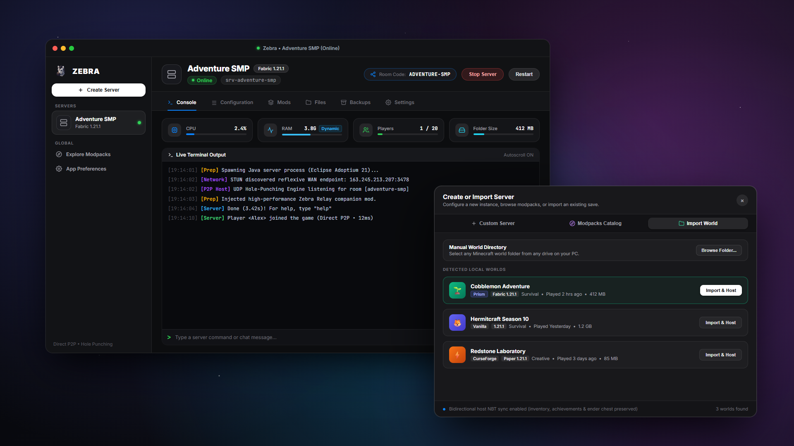

# Zebra

**Host and play Minecraft with your friends directly from your PC. No port forwarding, no router setup, no monthly hosting bills.**



## What is Zebra?

Playing Minecraft with friends shouldn't require paying for overpriced monthly hosting, waiting in 40-minute queues on free server hosts, or messing with your home router's port forwarding.

**Zebra** runs a dedicated server right on your own computer with full performance, zero queues, and unlimited render distance. Friends join in seconds using a room code.

---

## Features

- 🎮 **Zero Port Forwarding**: Share your room code and start playing. Nobody has to touch router settings or share their public IP.
- ⚡ **Full Hardware Performance**: Runs natively on your machine with direct peer-to-peer connections for minimal latency and maximum tick rates.
- 🗺️ **1-Click World Hosting**: Turn any singleplayer world into a multiplayer co-op server in one click, keeping your builds, chests, player inventories, and pets intact.
- 📦 **Modpack & Loader Support**: Full support for Fabric, NeoForge, Forge, Paper, and Vanilla. Search and install Modrinth modpacks directly inside the app, or drop in your own mods.
- 💾 **Automatic Backups**: Automated snapshots keep your worlds safe from crashes and corruption.

---

## Quick Start

1. Download **`Zebra-1.0.0-win-x64.exe`** from the [Releases](https://github.com/Cleawwy/Zebra/releases) page.
2. Pick your Minecraft version (or import a singleplayer world), then click **Start Server**.
3. Send the **Room Code** to your friends!

---

## How Friends Join

### Option 1: Zebra Companion Mod (Recommended)
1. Download [**`zebra-relay-1.0.0.jar`**](https://github.com/Cleawwy/Zebra/releases) from Releases.
2. Drop it into your Minecraft `mods/` folder (Fabric).
3. In the Multiplayer menu, click the **Zebra** button, enter the Room Code, and play!

### Option 2: Direct Connection (No Mod Required)
Friends without the mod can copy the direct connection link from your Zebra host window and paste it directly into Minecraft's **Direct Connection** box.

---

## Credits

- [**prismarine-nbt**](https://github.com/PrismarineJS/prismarine-nbt) — Singleplayer world NBT parsing.
- [**nat-upnp**](https://github.com/indutny/node-nat-upnp) — Universal Plug and Play router mapping.
- [**Lucide**](https://lucide.dev/) — User interface iconography.

---

## Development

```bash
# Clone the repository
git clone https://github.com/Cleawwy/Zebra.git
cd Zebra

# Install dependencies
npm install

# Start development mode
npm run dev

# Package production executable
npm run dist
```

---

## License

[MIT](LICENSE) © Cleawwy
